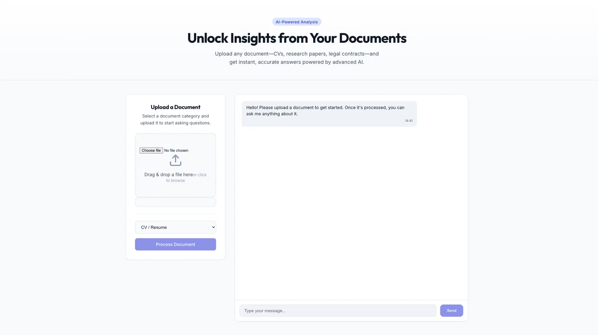
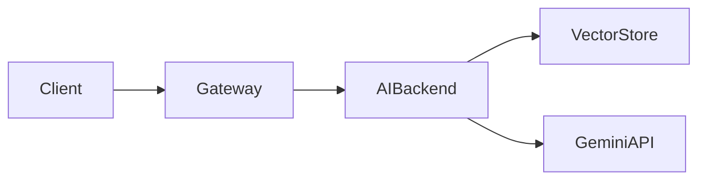

# RAG Document Engine

<div align="center">
  
</div>

<div align="center">
  <h3>
    <a href="https://github.com/shubhktr1012/rag-document-engine">GitHub Repository</a>
    <span> | </span>
    <span>Microservices Architecture</span>
    <span> | </span>
    <span>Dockerized Stack</span>
  </h3>
</div>

---

## Overview

A high-throughput Retrieval-Augmented Generation (RAG) platform enabling users to upload multi-page documents (PDF, TXT) and execute context-grounded semantic inquiries powered by Google Gemini 2.5 Flash and vector similarity indexing.

---

## System Architecture

The application is structured into decoupled microservices:

1. **Frontend (/frontend):** Single-page application built with React, Vite, and TypeScript. Provides real-time document drag-and-drop, query streaming, and citation inspection.
2. **API Gateway (/gateway):** GraphQL orchestration layer built with Node.js and Apollo Server. Serves as the unified schema entry point, mediating authentication, request batching, and routing to downstream services.
3. **AI Backend (/backend):** Asynchronous Python Flask engine utilizing LangChain and Google Generative AI. Coordinates document parsing, chunking, FAISS vector indexing with HuggingFace embeddings, and grounded synthesis.

---

## High-Level Pipeline Flow



---

## Tech Stack

* **Frontend:** React, TypeScript, Vite, Tailwind CSS
* **Gateway:** Node.js, Apollo Server, GraphQL, Express
* **Core Backend:** Python, Flask, LangChain, FAISS, HuggingFace Embeddings
* **LLM Engine:** Google Gemini 2.5 Flash
* **DevOps:** Docker, Docker Compose

---

## Quick Start with Docker Compose

1. Clone the repository:
```bash
git clone https://github.com/shubhktr1012/rag-document-engine.git
cd rag-document-engine
```

2. Configure environment credentials in `.env`:
```bash
GEMINI_API_KEY="your_api_key_here"
```

3. Launch the containerized stack:
```bash
docker-compose up --build
```

4. Service Endpoints:
* Frontend Interface: http://localhost:5173
* GraphQL Playground: http://localhost:4000/graphql
* Backend REST Engine: http://localhost:5001

---

## Manual Service Execution

### 1. Python Backend
```bash
cd backend
python -m venv venv
source venv/bin/activate
pip install -r requirements.txt
export GEMINI_API_KEY="your_api_key_here"
python app.py
```

### 2. Apollo GraphQL Gateway
```bash
cd gateway
npm install
npm start
```

### 3. React Frontend
```bash
cd frontend
npm install
npm run dev
```

---

## API Endpoints

### GraphQL Gateway
Endpoint: `http://localhost:4000/graphql`

```graphql
type Query {
  _empty: String
}

type Mutation {
  askCV(question: String!): String
}
```

### REST Backend
* `POST /upload-document`: Multipart file ingestion (PDF/TXT).
* `POST /ask`: JSON payload `{"question": "..."}` returning synthesized response and source citations.
* `POST /reset`: Flushes existing vector index from memory.
